<p align="center">
  
</p>

# 🎬 Awesome 2D Animation & Motion Graphic Frameworks

<a href="https://github.com/ishandutta2007/Awesome-Awesome-Awesome"></a><a href="https://discord.gg/jc4xtF58Ve"></a>
[](https://awesome.re)
[](https://github.com/ishandutta2007/Awesome-2D-Animation-Motion-Graphic-Frameworks/pulls)
[](https://creativecommons.org/publicdomain/zero/1.0/)
<a href="https://github.com/ishandutta2007"></a>

> 🚀 **The definitive, curated ecosystem directory of SaaS platforms, commercial suites, skeletal engines, vector runtimes, and open-source creative motion graphics code.**  
> Focused on 2D skeletal rigging, inverse kinematics (IK), vector tweening, frame-by-frame raster animation, and programmatic web/game runtimes.

---

## 📑 Table of Contents

- [📊 Sector Overview & Market Dynamics](#-sector-overview--market-dynamics)
- [💼 Commercial & SaaS Platforms](#-commercial--saas-platforms)
- [🌟 Top Open-Source Frameworks & Libraries](#-top-open-source-frameworks--libraries)
- [🧩 Specialized Animation Ecosystems](#-specialized-animation-ecosystems)
- [🛠️ Pipeline Architecture Suggestions](#-pipeline-architecture-suggestions)
- [🤝 How to Contribute](#-how-to-contribute)
- [💖 Support](#-support)
- [📈 Star History](#--star-history)
- [⚖️ Disclaimer & Licensing](#️-disclaimer--licensing)

---

## 📊 Sector Overview & Market Dynamics

The global animation software market is estimated at **$2.7B to $7.0B+** (as part of the broader **$150B–$280B+** digital media, visual effects, and gaming content ecosystem), expanding at a 7.7%–12.7% CAGR through 2030 driven by explainer videos, web UI micro-interactions, VTubing, and indie gaming.

The sector exhibits a **hybrid market structure**:
* **High-End Studio Tier (Concentrated):** Studio-scale 2D animation and production rigging are **moderately concentrated** around entrenched category leaders like Adobe (Adobe Animate, After Effects) and Francisco Partners / TPG's Toon Boom Harmony, which control standard enterprise broadcast, television, and film pipelines.
* **Indie, Web & Interactive Tier (Highly Fragmented):** Outside studio broadcast walls, the market is **highly fragmented** among specialized skeletal rigging suites (Spine 2D, Live2D Cubism), modern cloud vector state-machine platforms (Rive), and community-driven open-source creative engines (Remotion, GSAP, Manim, Lottie, OpenToonz).

---

## 💼 Commercial & SaaS Platforms

The table below outlines key commercial tools and SaaS animation suites, sorted in descending order by **Company Size / Valuation / Revenue**.

| SaaS / Platform | Company Scale / Valuation / Revenue | Starting Tier Pricing | Free Tier / Free Trial Limits | Primary Use Case & Core Capabilities |
| :--- | :--- | :--- | :--- | :--- |
| **[Adobe Animate](https://www.adobe.com/products/animate.html)** | 🏢 **~$95 Billion** Market Cap (~$24B Annual Revenue) | **$20.99/mo** (Annual commitment paid monthly; or $34.49/mo month-to-month) | **7-day free trial**; fully unlocked features during trial, requires billing method upfront, auto-renews unless cancelled | Industry-standard vector motion graphics, interactive HTML5 canvas, WebGL authoring, and timeline animation. |
| **[Toon Boom Harmony](https://www.toonboom.com/products/harmony)** | 🏢 **~$112 Million** ($147.5M CAD) Acquisition Valuation (TPG / IMC) | **$31.00/mo** (Harmony Essentials monthly; or $259/year billed annually) | **14-day free trial**; full feature access of chosen tier, single machine activation, non-renewable, no card charge | Studio-grade broadcast 2D cut-out character rigging, node-based compositing, paperless frame-by-frame bitmap/vector art. |
| **[Live2D Cubism](https://www.live2d.com/en/)** | 🏢 **Majority owned by Sony Music / Aniplex** (~$30M+ Capital/Ecosystem, 130+ employees) | **¥1,573/mo** (~$11/mo billed annually; or ¥2,299/mo month-to-month for indie PRO) | **Permanent Free Tier** (Max 2 parameters per artmesh, capped 2048x2048 texture atlas, limited to businesses &lt;¥10M JPY/year); plus **42-day unrestricted PRO trial** | 2D dynamic mesh deformation converting flat illustrations into real-time reactive avatars for VTubers, visual novels, and mobile games. |
| **[Rive](https://rive.app)** | 🏢 **$14M–$22.5M** VC Funding (~$5.4M Annual Recurring Revenue) | **$32.00/mo** (Cadet tier annual; or $40/mo month-to-month) | **Permanent Free Tier** ($0/mo with unlimited private personal files, 3 collaborative files, 1 shared team project, 50 CLI pushes/mo; exported runtime `.riv` files include a Rive splash screen) | Collaborative cloud-based vector animation with state machines, data binding, and low-latency interactive runtimes for Flutter, React, iOS, Android, and WebGL. |
| **[Spine 2D](https://esotericsoftware.com/)** | 🏢 **Bootstrapped / Profitable Private Enterprise** (~$1M–$5M Est. Revenue) | **$69.00** one-time perpetual license (Spine Essential; $369 for Spine Professional) | **Free Evaluation Trial** (Indefinite trial with pre-bundled sample rigs; saving projects, texture packing, and animation data/video exporting are completely disabled) | Gold-standard 2D skeletal bone rigging and mesh skinning built specifically for indie and AAA game development runtimes. |
| **[Moho Pro](https://lostmarble.com/)** | 🏢 **$750,000** Acquisition Baseline (Lost Marble LLC) | **$59.99** one-time perpetual license (Moho Debut 14; $399.99 for Moho Pro 14) | **30-day free trial** (15 days initial + 15 days upon email entry; project saving works, but exporting video/external formats and importing external images/movies are disabled; watermark present) | Professional 2D vector animation featuring Smart Bones, pin bones, physics simulation, quad meshes, and automated lip-sync. |
| **[TVPaint Animation](https://www.tvpaint.com/)** | 🏢 **Privately Held Independent** (~$1M–$4M Est. Revenue, Metz, France) | **€650.00** (~$705 USD) one-time perpetual license (TVPaint Standard; €1,250 for Professional) | **Free Evaluation Demo** (Indefinite access to test Professional tools and brush engine; project saving, exporting, and rendering are disabled) | Traditional raster frame-by-frame digital animation and paperless studio production with custom digital brushes and light table onion skinning. |
| **[DragonBones Pro](https://www.egret.com/en/)** | 🏢 **Privately Held** (Beijing Egret Technology Co., Ltd.) | **$0.00** (100% Freeware editor with open-source runtimes) | **Free Forever** (Completely unlocked with zero licensing fees; no time or feature caps for personal or commercial use; legacy maintenance status) | Freeware 2D skeletal animation editor featuring bone kinematics, mesh deformation, and multi-engine runtime libraries for web and mobile games. |

---

## 🌟 Top Open-Source Frameworks & Libraries

Curated open-source animation engines, frameworks, programmatic video generators, and desktop suites. Sorted by GitHub **Stars_Count** (descending).

| Project | GitHub_Stars | Primary Language / Stack | Architecture & Description |
| :--- | :--- | :--- | :--- |
| **[anime.js](https://github.com/juliangarnier/anime)** | [](https://github.com/juliangarnier/anime/stargazers) | JavaScript / TypeScript | Lightweight JavaScript animation engine with a clean API for CSS properties, SVG paths, DOM attributes, and JS objects. |
| **[Remotion](https://github.com/remotion-dev/remotion)** | [](https://github.com/remotion-dev/remotion/stargazers) | React / TypeScript | Programmatic video creation suite using web technologies; write React components to render 2D motion graphics and export server-side MP4s. |
| **[PixiJS](https://github.com/pixijs/pixijs)** | [](https://github.com/pixijs/pixijs/stargazers) | JavaScript / WebGL / WebGPU | The HTML5 Creation Engine: Ultra-fast 2D WebGL/WebGPU renderer powering rich interactive animations, spritesheets, and skeletal meshes. |
| **[Manim Community](https://github.com/ManimCommunity/manim)** | [](https://github.com/ManimCommunity/manim/stargazers) | Python / Cairo / OpenGL | Community-maintained Python animation engine for creating precise mathematical motion graphics, vector animations, and educational videos. |
| **[Phaser](https://github.com/phaserjs/phaser)** | [](https://github.com/phaserjs/phaser/stargazers) | JavaScript / TypeScript | Fast, robust 2D game framework providing timeline tweens, particle systems, camera motion, and integrated 2D skeletal animation support. |
| **[Motion](https://github.com/motiondivision/motion)** | [](https://github.com/motiondivision/motion/stargazers) | TypeScript / React / Vue | Production-ready declarative animation and gesture library (formerly Framer Motion) for React, Vue, and vanilla JavaScript. |
| **[Lottie Web](https://github.com/airbnb/lottie-web)** | [](https://github.com/airbnb/lottie-web/stargazers) | JavaScript / Bodymovin | Renders Adobe After Effects animations exported as JSON via Bodymovin natively across Web, iOS, Android, and desktop. |
| **[GSAP](https://github.com/greensock/GSAP)** | [](https://github.com/greensock/GSAP/stargazers) | JavaScript | Ultra-high-performance professional web animation platform powering complex timeline sequences, SVG morphing, and scroll triggers. |
| **[Rough.js](https://github.com/rough-stuff/rough)** | [](https://github.com/rough-stuff/rough/stargazers) | JavaScript / Canvas / SVG | Graphics library that lets you draw in a sketchy, hand-drawn-like style; perfect for sketchy procedural 2D animations and charts. |
| **[Theatre.js](https://github.com/theatre-js/theatre)** | [](https://github.com/theatre-js/theatre/stargazers) | TypeScript / Three.js / React | Visual motion design and keyframing timeline tool that plugs directly into web code to choreograph DOM, Three.js, or Canvas animations. |
| **[SVG.js](https://github.com/svgdotjs/svg.js)** | [](https://github.com/svgdotjs/svg.js/stargazers) | JavaScript / SVG | Lightweight library for manipulating and animating SVG graphics with zero dependencies and a clean, chainable syntax. |
| **[node-canvas](https://github.com/Automattic/node-canvas)** | [](https://github.com/Automattic/node-canvas/stargazers) | C++ / Node.js / Cairo | Cairo-backed Canvas implementation for Node.js, enabling server-side frame-by-frame 2D graphics rendering and video generation. |
| **[tween.js](https://github.com/tweenjs/tween.js)** | [](https://github.com/tweenjs/tween.js/stargazers) | JavaScript / TypeScript | Super simple, fast, and flexible JavaScript/TypeScript tweening engine for smooth numeric interpolation and easing functions. |
| **[EffectCraft](https://github.com/storytold/effectcraft)** | [](https://github.com/storytold/effectcraft/stargazers) | Rust / WGPU | Pure Rust motion graphics and visual effects compositor featuring keyframe timelines, curve editing, and 300+ GPU shaders. |
| **[OpenToonz](https://github.com/opentoonz/opentoonz)** | [](https://github.com/opentoonz/opentoonz/stargazers) | C++ / Qt | Full-featured studio 2D production animation suite based on Studio Ghibli's custom software (Toonz Ghibli Edition). |
| **[Spine Runtimes](https://github.com/EsotericSoftware/spine-runtimes)** | [](https://github.com/EsotericSoftware/spine-runtimes/stargazers) | C++ / C# / JS / Rust | Official open-source game runtimes for loading and rendering Spine 2D skeletal animations across 20+ engines (Unity, Godot, Unreal, Pixi). |
| **[canvas-sketch](https://github.com/mattdesl/canvas-sketch)** | [](https://github.com/mattdesl/canvas-sketch/stargazers) | JavaScript | Framework for making generative artwork and algorithmic 2D motion graphics in JavaScript and HTML5 canvas. |
| **[Synfig Studio](https://github.com/synfig/synfig)** | [](https://github.com/synfig/synfig/stargazers) | C++ / GTK | Industrial-strength open-source vector 2D animation suite with bone rigging, spatial deformers, and automated mathematical tweening. |
| **[Pencil2D](https://github.com/pencil2d/pencil)** | [](https://github.com/pencil2d/pencil/stargazers) | C++ / Qt | Minimalist open-source cross-platform tool focused on traditional frame-by-frame hand-drawn raster and vector animation. |
| **[reanimate](https://github.com/NiazMorshed2007/reanimate)** | [](https://github.com/NiazMorshed2007/reanimate/stargazers) | TypeScript / Python | Autonomous AI agent skill that reverse-engineers web or video animations frame-by-frame and rebuilds them into production CSS, GSAP, and Motion code. |
| **[Rive Runtime](https://github.com/rive-app/rive-runtime)** | [](https://github.com/rive-app/rive-runtime/stargazers) | C++ / WebAssembly | Cross-platform multi-target runtime engine executing real-time Rive state machine vector animations with zero drop in framerate. |
| **[DragonBonesJS](https://github.com/DragonBones/DragonBonesJS)** | [](https://github.com/DragonBones/DragonBonesJS/stargazers) | TypeScript / JavaScript | Open-source TypeScript/JavaScript runtimes for rendering DragonBones 2D skeletal animations in PixiJS, Phaser, and Egret. |
| **[Wick Editor](https://github.com/Wicklets/wick-editor)** | [](https://github.com/Wicklets/wick-editor/stargazers) | JavaScript / HTML5 | Beginner-friendly browser-based animation and game creation platform inspired by classic Flash workflows. |
| **[Spine Animation AI](https://github.com/GenielabsOpenSource/spine-animation-ai)** | [](https://github.com/GenielabsOpenSource/spine-animation-ai/stargazers) | Python / PyTorch | AI-assisted pipeline generating skeletal keyframes and walking/action cycles directly compatible with 2D bone structures. |
| **[Tahoma2D](https://github.com/tahoma2d/tahoma2d)** | [](https://github.com/tahoma2d/tahoma2d/stargazers) | C++ / Qt | User-focused fork of OpenToonz offering modern UI conveniences, streamlined stop-motion workflows, and simplified brush tools. |
| **[MotionGfx](https://github.com/voxell-tech/motiongfx)** | [](https://github.com/voxell-tech/motiongfx/stargazers) | Rust / Bevy | Backend-agnostic motion graphics framework written in Rust with relative timing actions, cubic bezier curves, and Bevy engine bindings. |
| **[Rigby2D](https://github.com/jaisurya-dev-art/rigby2d)** | [](https://github.com/jaisurya-dev-art/rigby2d/stargazers) | Rust / WGPU / Bevy | Open-source 2D skeletal animation editor featuring automated PSD layer rigging, deformable meshes, IK chains, and Godot runtimes. |
| **[SkelForm](https://github.com/Retropaint/skelform)** | [](https://github.com/Retropaint/skelform/stargazers) | Rust / WGPU | Ultra-lightweight open-source 2D skeletal animation authoring tool powered by FABRIK inverse kinematics and modern graphics APIs. |
| **[Anymotion](https://github.com/anymotion-agent/anymotion)** | [](https://github.com/anymotion-agent/anymotion/stargazers) | Python / TypeScript | Generative AI motion agent creating programmatic kinetic typography and SaaS explainer video code from plain natural language. |
| **[Open Motion](https://github.com/Hada45/Open-Motion)** | [](https://github.com/Hada45/Open-Motion/stargazers) | JavaScript / WebGL | Web-based open-source keyframe motion graphics editor inspired by Alight Motion featuring visual easing curves and layer compositing. |

---

## 🧩 Specialized Animation Ecosystems

Explore dedicated subsets of the 2D animation ecosystem tailored to specific operational stacks:

### 🎮 Game Skeletal Runtimes & Rigging
* **[Spine 2D](https://esotericsoftware.com)** — Commercial benchmark for 2D meshes, IK, weights, and cross-platform game performance.
* **[Rigby2D](https://github.com/jaisurya-dev-art/rigby2d)** — Rust-native desktop alternative with PSD layer importing and Godot/Unity runtime support.
* **[DragonBones](https://github.com/DragonBones/DragonBonesJS)** — Freeware authoring suite with community-driven HTML5 and native game engine runtimes.
* **[SkelForm](https://github.com/Retropaint/skelform)** — Minimalist Rust editor with fast FABRIK IK solving.

### 🌐 Web & Interactive UI Micro-Interactions
* **[anime.js](https://github.com/juliangarnier/anime)** & **[GSAP](https://github.com/greensock/GSAP)** — High-framerate browser DOM and SVG morphing with timeline control.
* **[Motion](https://github.com/motiondivision/motion)** — Declarative spring physics and gesture choreography for modern React/Vue applications.
* **[Rive](https://rive.app)** & **[Rive Runtime](https://github.com/rive-app/rive-runtime)** — State machine interactive graphics rendered in real time at 120 FPS.
* **[Lottie Web](https://github.com/airbnb/lottie-web)** — Scalable vector JSON animation playback across web, iOS, and Android.

### 🐍 Programmatic Video & Generative Code
* **[Remotion](https://github.com/remotion-dev/remotion)** — Write React and TypeScript to generate pixel-perfect MP4 videos programmatically.
* **[Manim](https://github.com/ManimCommunity/manim)** — Python-driven engine for mathematical animations and vector explainers.
* **[reanimate](https://github.com/NiazMorshed2007/reanimate)** — AI agent for analyzing existing motion videos and emitting verified CSS/JS animation code.

---

## 🛠️ Pipeline Architecture Suggestions

Combine open-source and commercial engines to build modular, zero-lock-in pipelines:

```
[Illustration / Design]
       │
       ├─► PSD / Vector Assets ──► Rigby2D / Spine 2D ──► Skeletal Game Runtimes (Godot/Unity/PixiJS)
       │
       ├─► Vector Layers (.SVG) ──► Glaxnimate / Rive ──► Interactive Web Runtimes (.riv / Lottie JSON)
       │
       └─► Hand-drawn Keyframes ─► OpenToonz / Pencil2D ─► Broadcast / Video Output (MP4 / WebM)
```

---

## 🤝 How to Contribute

Contributions are welcome! Please follow these steps to add or update projects:

1. 🍴 **Fork** this repository.
2. 🌿 Create a descriptive branch: `git checkout -b feature/add-new-framework`.
3. ✏️ Add your entry adhering to alphabetical or star-count sorting:
   * **For SaaS:** Include platform name, company scale/valuation, specific starting tier price, and specific free tier/trial limits.
   * **For Open-Source:** Include repo link, social Stars_Badge (`style=social&color=white`), core stack, and description.
4. 🚀 Commit your updates: `git commit -m "feat: add NewFramework to open-source list"`.
5. 📤 Push your branch and open a **Pull Request**.

---

## 💖 Support

Thank you for exploring and utilizing the **Awesome 2D Animation & Motion Graphic Frameworks** directory! 🎉

If you find this repository helpful for your projects, pipelines, or creative journey, please consider supporting it:
* ⭐ **Star** this repository to help other animators, developers, and motion designers discover it.
* 🍴 **Fork** and contribute new frameworks, runtimes, or tools.
* 📢 **Share** it with your developer and creative technologist communities.
* ☕ **Buy a Coffee / Sponsor**: Show extra love by supporting via the [GitHub Sponsors Dashboard](https://github.com/sponsors/ishandutta2007).

---

## 📈 Star History

[](https://www.star-history.com/#ishandutta2007/Awesome-2D-Animation-Motion-Graphic-Frameworks&type=date&legend=top-left)

---

## ⚖️ Disclaimer & Licensing

* This repository is an independent, community-curated directory and is not officially affiliated with or endorsed by any listed company or vendor.
* Commercial software licenses and runtimes (e.g., Spine, Live2D) require respective commercial distribution agreements when deployed in commercial games or client apps.
* Open-source repositories are governed by their respective individual licenses (MIT, Apache-2.0, GPL-3.0, BSD). Always verify license terms prior to commercial deployment.
